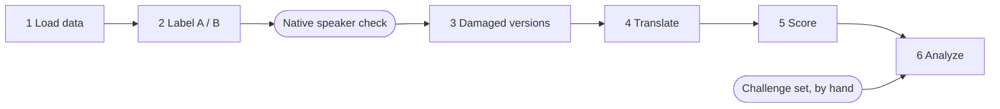

# The Keyboard Tax

What diacritic loss costs machine translation.
Course project for *Essentials in Text and Speech Processing*
Lucia Ivan, Karen Olivia Reyes Mendoza, Thomas Schurter.

## Goal

People often type Portuguese without accents. Some words then turn into other real words
(*pôde* "could" becomes *pode* "can"). We translate Portuguese into English and test whether
this changes the meaning, and whether the usual translation scores notice.

- **Class A:** without its accent, the word is not a word (*não → nao*). Looks like a typo.
- **Class B:** without its accent, the word is another real word (*pôde → pode*). Looks fine, means something else.

## Pipeline



| Step | File | Owner | Writes |
|---|---|---|---|
| 1 | `data.py` | Coder 1 | `outputs/1_sentences.csv` |
| 2 | `classify.py` | Coder 1 | `outputs/2_lexicon_auto.csv`, `outputs/2_letters.csv` |
| review | by hand | native speaker | `data/lexicon.csv` |
| challenge set | by hand | Researcher + native speaker | `data/challenge_set.csv` |
| 3 | `versions.py` | Coder 1 | `outputs/3_versions.csv` |
| 4 | `translate.py` | Coder 2 | `outputs/4_translations.csv` |
| 5 | `score.py` | Coder 2 | `outputs/5_scores.csv`, `outputs/5_corpus_scores.csv` |
| 6 | `analyze.py` | Coder 2 | `outputs/6_results/` |

Each step reads the file the step before wrote. The columns of every file are fixed in
`src/keyboard_tax/common.py`, and `tests/fixtures/` has a small example of each one, so any
step can be built before the previous step is finished. The to-do list for each step is at
the top of its file.

## Run it

```bash
python3 -m venv .venv
source .venv/bin/activate
pip install -e ".[dev]"
pytest                                          # run the tests
python -m keyboard_tax.versions --fixtures      # run a step on the example data
python -m keyboard_tax.versions                 # run a step on the real data
```

All settings (models, seed, thresholds) are in `config.yaml`.

## How we work

| Role | Name | Owns |
|---|---|---|
| Researcher | | `literature/`, `notes/dataset.md`, the challenge set, the decisions in `notes/decisions.md` |
| Coder 1 | | Steps 1–3 |
| Coder 2 | | Steps 4–6 |

- One branch per task, merged through a pull request that a teammate reviews.
- Short commit messages that say what changed: `Add accent stripping`.
- Changes to `classify.py` always get a second reader: a bug there changes the main result.
- Every decision goes in `notes/decisions.md`; every use of an AI tool in `notes/ai_use.md`.
- The report is written in Overleaf; its plan is `report/outline.md`.
- Files in `outputs/` are generated: never edit or commit them.

## Project map

```
config.yaml      all settings
src/keyboard_tax/
  common.py      shared helpers: settings, file names and columns, accent stripping
  data.py        step 1  load FLORES+
  classify.py    step 2  label Class A / B
  versions.py    step 3  damaged versions
  translate.py   step 4  three translation systems
  score.py       step 5  BLEU, chrF, COMET
  analyze.py     step 6  tables, charts, regression
data/            data we create and release (CC BY-SA 4.0)
tests/           tests, and example data in fixtures/
literature/      literature review: one entry per paper (no PDFs)
report/          report plan, section by section
notes/           decisions, dataset notes, AI use, Thomas's notes and demos
outputs/         created by the code, not committed
```

## License

Code: MIT (`LICENSE`). Data in `data/`: CC BY-SA 4.0, see `data/README.md`.
