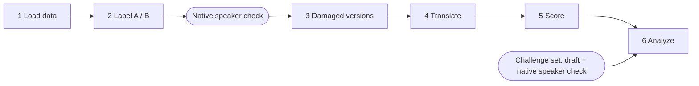

# The Keyboard Tax

What diacritic loss costs machine translation.
Course project for *Essentials in Text and Speech Processing*
Lucia Ivan, Karen Olivia Reyes Mendoza, Thomas Schurter.

## Goal

People often type Portuguese without accents. Some words then turn into other real words
(*pôde* "could" becomes *pode* "can"). We translate Portuguese into English and test whether
this changes the meaning, and whether the usual translation scores notice.

- **Class A:** without its accent, the word is not a word (*não → nao*). Looks like a typo.
- **Class B:** without its accent, the word is another real word (*pôde → pode*). Looks fine, means something else.

## Pipeline



| Step | File | Owner | Writes |
|---|---|---|---|
| 1 | `data.py` | Coder 1 | `outputs/1_sentences.csv` |
| 2 | `classify.py` | Coder 1 | `outputs/2_lexicon_auto.csv`, `outputs/2_letters.csv` |
| review | by hand | Coder 1 (native speaker) | `data/lexicon.csv` |
| challenge set | `challenge.py`, then by hand | draft: Coder 2; check: Coder 1 (native speaker) | `data/challenge_set.csv` |
| 3 | `versions.py` | Coder 1 | `outputs/3_versions.csv` |
| 4 | `translate.py` | Coder 2 | `outputs/4_translations.csv` |
| 5 | `score.py` | Coder 2 | `outputs/5_scores.csv`, `outputs/5_corpus_scores.csv` |
| 6 | `analyze.py` | Coder 2 | `outputs/6_results/` (tables, charts, `summary.txt`) |

Each step reads the file the step before wrote. The columns of every file are fixed in
`src/keyboard_tax/common.py`, and `tests/fixtures/` has a small example of each one, so any
step can be built before the previous step is finished. Each file starts with a short
description of what the step does.

## Results

Open **`results.ipynb`**: the idea, every result with its chart and a short explanation.
It runs in a few seconds on any laptop (no GPU, no model, no dataset login), and its outputs
are stored in the file, so it can also just be read.

## Run it

```bash
python3 -m venv .venv
source .venv/bin/activate
pip install -e ".[dev]"                         # tests, results.ipynb, steps 1-3 and 6
scripts/get_dictionary.sh                       # pt_BR dictionary for step 2, to data/raw/
pytest                                          # run the tests: 97 passed
python -m keyboard_tax.versions --fixtures      # run a step on the example data
python -m keyboard_tax.versions                 # run a step on the real data
```

Steps 4 and 5 also need the models: `pip install -e ".[dev,models]"`, on Python 3.11 or 3.12
(torch has no release for Python 3.14 yet). For the full data they need a GPU: open
`scripts/colab_gpu_run.ipynb` in Google Colab (about one hour in all). Results come back as a zip; unzip it into `outputs/`.
On a laptop, try step 4 on the example data with
`python -m keyboard_tax.translate --fixtures --systems opus_mt`.

Step 6 runs on a laptop: `python -m keyboard_tax.analyze --save-results` (also refreshes `results/`).

All settings (models, seed, thresholds) are in `config.yaml`.

## How we work

| Role | Name | Owns |
|---|---|---|
| Coder 1 | Thomas Schurter | Steps 1–3; review of the word list and of the challenge set as native speaker |
| Coder 2 | Karen Olivia Reyes Mendoza | Steps 4–6; draft of the challenge set; `notes/dataset.md`; the entries in `literature/papers.md` |
| Researcher | Lucia Ivan | Report structure (first draft of `report/outline.md`); the search topics in `literature/papers.md`; ideas for future work |

- One branch per task, merged through a pull request that a teammate reviews.
- Short commit messages that say what changed: `Add accent stripping`.
- Changes to `classify.py` always get a second reader: a bug there changes the main result.
- The use of AI tools is declared in the report.
- The report is written in Overleaf; its plan is `report/outline.md`.
- Files in `outputs/` are generated: never edit or commit them.

## Project map

```
config.yaml      all settings
src/keyboard_tax/
  common.py      shared helpers: settings, file names and columns, accent stripping
  data.py        step 1  load FLORES+
  classify.py    step 2  label Class A / B
  versions.py    step 3  damaged versions
  translate.py   step 4  three translation systems
  score.py       step 5  BLEU, chrF, COMET
  challenge.py   draft of the challenge set (for step 6)
  analyze.py     step 6  tables, charts, targeted check, hypotheses
data/            data we create and release (CC BY-SA 4.0)
tests/           tests, and example data in fixtures/
literature/      literature review: one entry per paper (no PDFs)
report/          report plan, section by section
results.ipynb    all results with charts and explanations: start here
results/         the scores the notebook reads (numbers only, no sentences)
notes/           how each part was built (steps 1-3, steps 4-6), dataset notes, demos
outputs/         created by the code, not committed (contains FLORES+ sentences)
```

## License

Code: MIT (`LICENSE`). Data in `data/`: CC BY-SA 4.0, see `data/README.md`.
